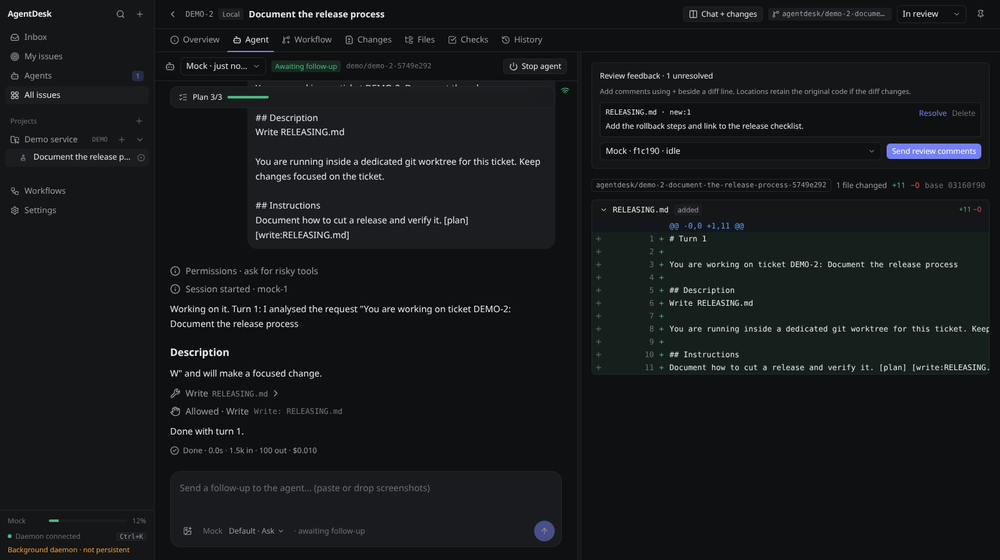
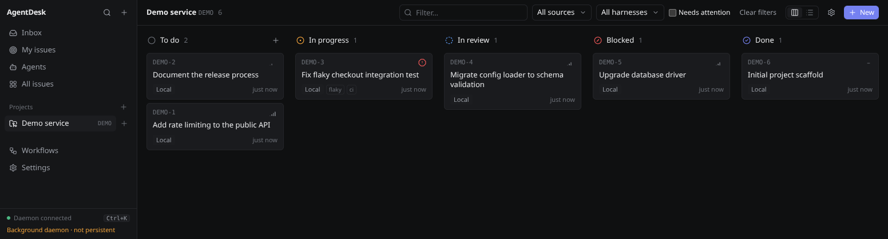
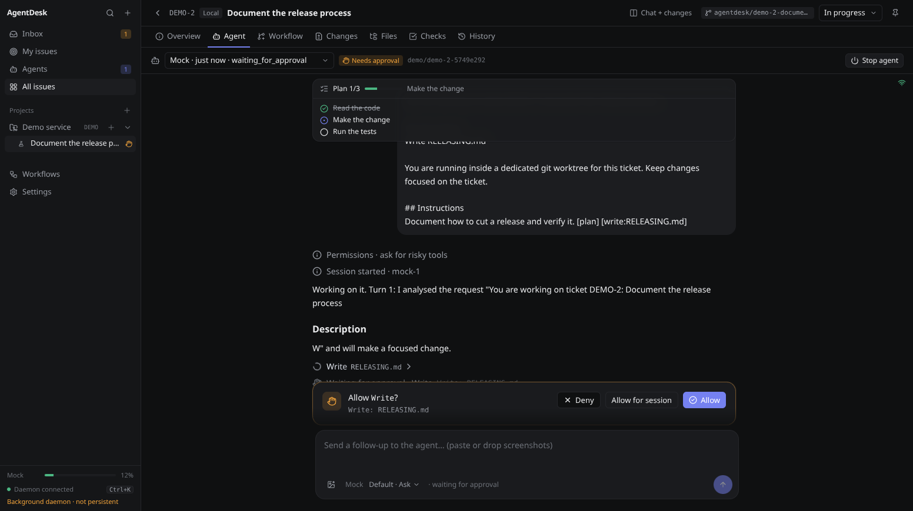
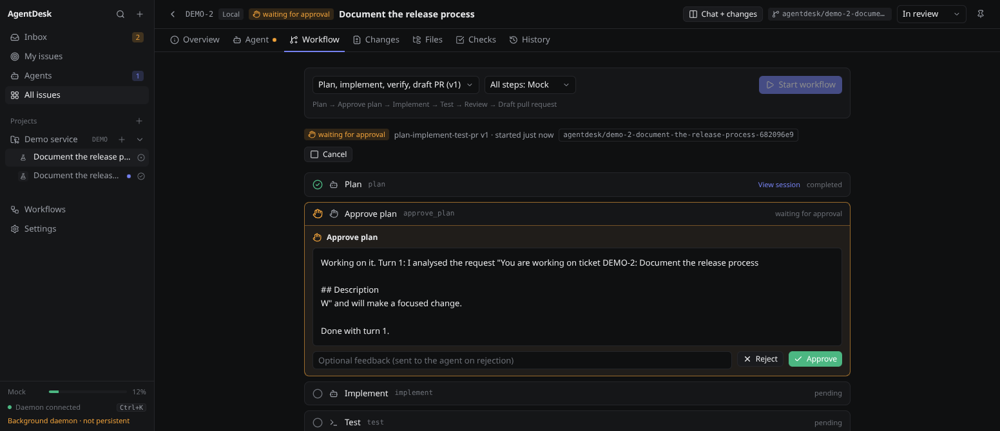

<p align="center">
  
</p>

<h1 align="center">AgentDesk</h1>

<p align="center"><strong>A local desktop workspace for Claude Code, Codex, and OpenCode.</strong></p>

<p align="center">
  Give an agent a ticket, answer questions and approve tool calls as it works, then review its diff before opening a draft PR.
</p>

<p align="center">
  <a href="#try-it">Try it</a> · <a href="#how-work-flows">How work flows</a> · <a href="#command-line">CLI</a> · <a href="#development">Development</a>
</p>

[](docs/screenshots/review-changes.png)

*Chat + changes keeps the conversation, worktree diff, and review comments in one view. Screenshots use AgentDesk’s built-in mock agent and demo tickets.*

## Try it

Build and run from source with **Node.js 22.12+**, **pnpm** (version pinned in [package.json](package.json)), and **Git**.

```bash
git clone https://github.com/bmz1/agentdesk.git
cd agentdesk
pnpm install --frozen-lockfile
pnpm dev:daemon
```

In a second terminal, from the checkout:

```bash
pnpm seed:demo
pnpm dev:desktop
```

1. Open **Demo service** and pick **Document the release process**.
2. Select **Agent → Start agent**. The demo project already uses the built-in mock agent, so it needs no provider account.
3. Allow the file write, then open **Chat + changes** to see the worktree diff and leave a line comment.

To work on your own code, register a local Git repository in **Projects** and select an installed, authenticated harness. **Settings → Harnesses** shows what the daemon detects. See [Operations](docs/operations.md#harness-login) for harness sign-in. Draft PRs to GitHub or GitLab use an authenticated `gh` or `glab` CLI.

<details>
<summary>Run the UI in a browser</summary>

Keep the daemon running and start `pnpm dev:web`. With the default local configuration, print the one-time connection URL and open it in your browser:

```bash
printf 'http://localhost:5173/?daemon=http://127.0.0.1:4317&token=%s\n' "$(cat ~/.agentdesk/token)"
```

The URL contains your local daemon token. Electron connects automatically using `~/.agentdesk/daemon.json`.

</details>

## How work flows

### Bring your tickets

Import selected **Jira Cloud**, **Jira Data Center**, or **Linear** issues alongside local tickets. Move cards through your local board while the source issues remain read-only. For exploratory work, open a **thread** and use **Track on board** when it becomes a task.

[](docs/screenshots/ticket-board.png)

### Run agents in parallel

Pick a harness, model, and permissions per ticket. Each ticket or thread gets a Git worktree and branch, so different tasks can run against the same repository without editing the same checkout. Set a project setup script if new worktrees need dependencies or configuration.

The **Agents** view shows which sessions are working, need input, or are ready for follow-up. The **Inbox** collects pending approvals and unread updates. Approve or deny tool calls and answer agent questions directly in the conversation. A finished agent turn leaves the ticket’s board status under your control. Open the command palette with **⌘K / Ctrl+K** or jump to the next agent that needs you with **⌘J / Ctrl+J**.

[](docs/screenshots/agent-approval.png)

### Review changes and open a draft PR

Leave comments on individual diff lines and send unresolved feedback back to an agent with the original code and line context.

For repeatable work, run a [versioned YAML workflow](docs/workflows.md). The bundled [plan-to-PR workflow](workflows/plan-implement-test-pr.yaml) pauses for plan approval, implements the change, runs the project’s tests with bounded retries, and runs an agent review. It asks for approval again before opening a draft PR.

[](docs/screenshots/workflow-plan.png)

## What runs locally

The Electron app and CLI talk to a loopback-only, token-authenticated daemon over HTTP. The daemon owns the agent processes, streams events to the UI over SSE, and stores tickets, transcripts, and workflow state in SQLite. It keeps running when the app window closes. If the daemon restarts, interrupted sessions and workflows can be resumed. See [Architecture](docs/architecture.md) and [Recovery behavior](docs/operations.md#recovery-behaviour).

Git worktrees provide checkout isolation. Process isolation depends on the harness and sandbox configuration. Model requests use the provider configured in your harness. See [Security](docs/security.md) for permissions and the trust boundary.

## Command line

Run these from the AgentDesk checkout. Use `--project` when starting work for a different registered repository.

```bash
pnpm agentdesk ls --attention
pnpm agentdesk new "Add a /health endpoint" --project DEMO --wait
pnpm agentdesk send DEMO-2 "Add a test for the error case" --wait
pnpm agentdesk events --json
```

Run `pnpm agentdesk --help` for commands and exit codes. To call `agentdesk` directly from other repositories or scripts, run `pnpm --filter @agentdesk/cli build` and expose `apps/cli/dist/main.js` on your `PATH` as `agentdesk`.

## Development

| Area | Location |
| --- | --- |
| Electron shell and React renderer | [apps/desktop](apps/desktop) |
| Effect services, Hono API, and agent supervision | [apps/daemon](apps/daemon) |
| CLI | [apps/cli](apps/cli) |
| Provider adapters, shared contracts, SQLite schema, Git, and workflow engine | [packages](packages) |

```bash
pnpm typecheck
pnpm test
pnpm build
pnpm --filter @agentdesk/desktop exec playwright install chromium
pnpm e2e
```

Browser E2E tests use the app renderer, a real daemon, and the mock harness. See [Operations](docs/operations.md) for configuration and troubleshooting, and [AGENTS.md](AGENTS.md) for test commands that exercise native Electron behavior and authenticated harnesses.
